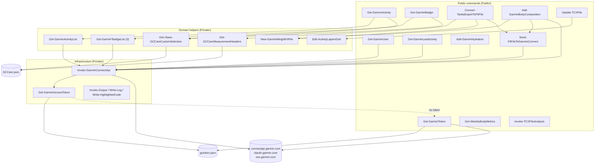
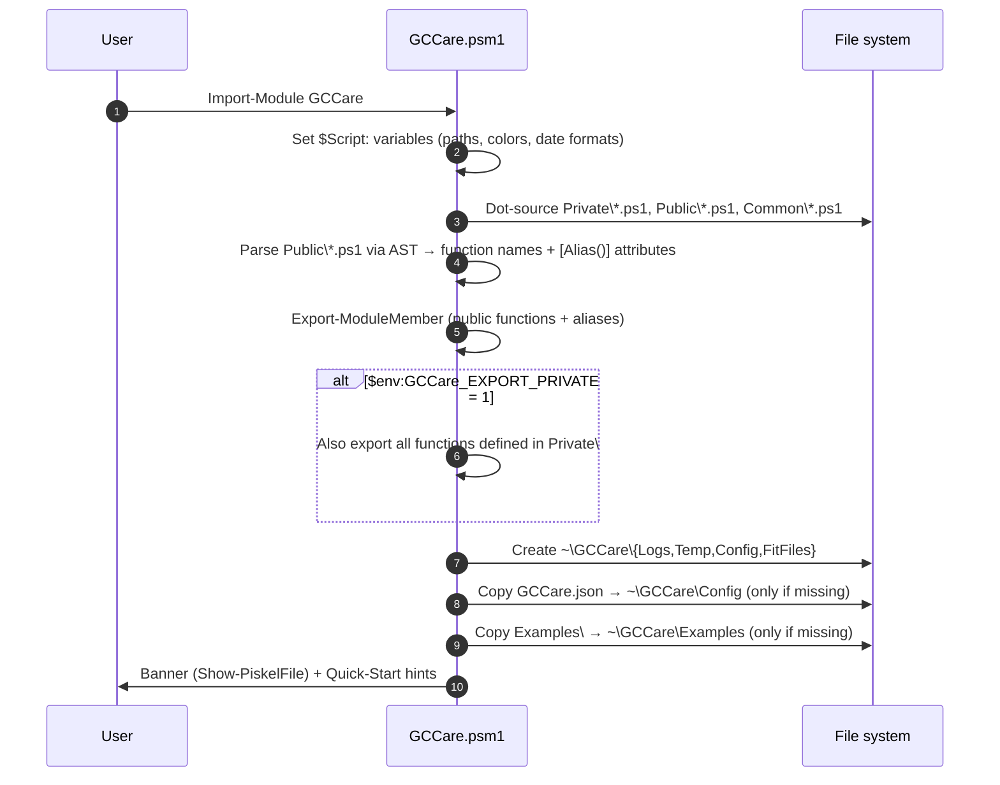
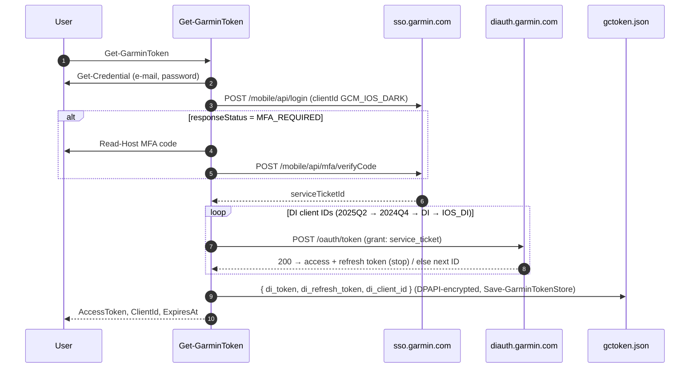
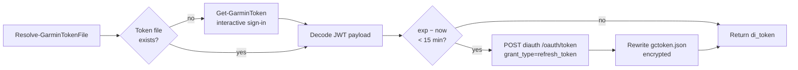
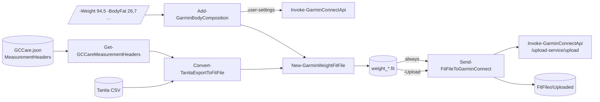
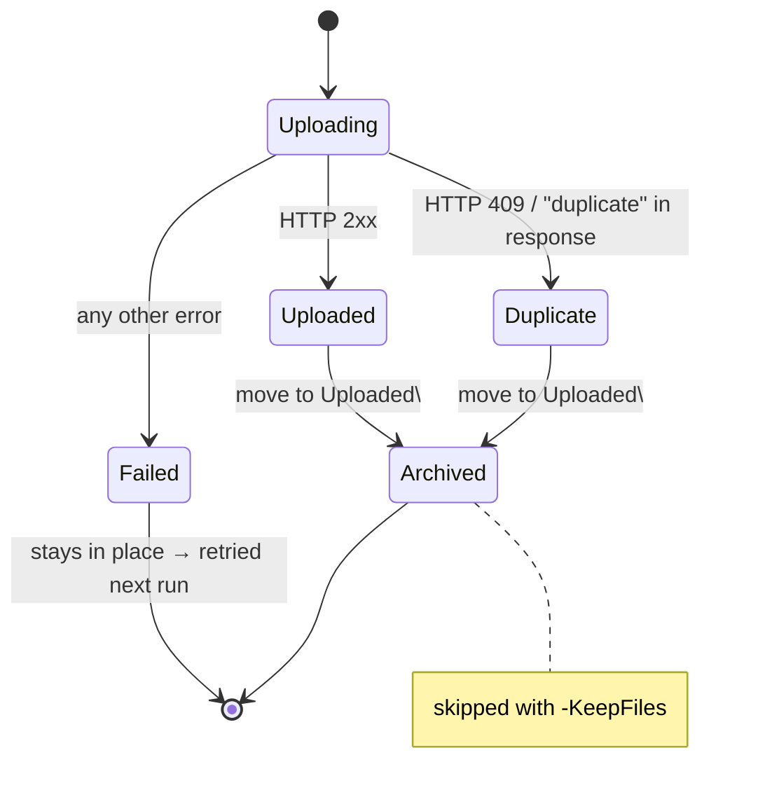
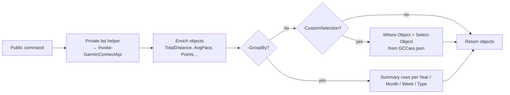

# GCCare – Architecture Overview

> Wiki-style deep dive into the internal structure of the GCCare module.
> For installation and usage, see the [README](../README.md). For the Garmin Connect endpoint reference, see [GarminConnectApi.md](GarminConnectApi.md).

**Contents**

1. [Overview](#1-overview)
2. [Layered architecture](#2-layered-architecture)
3. [Module loading](#3-module-loading)
4. [Authentication and token handling](#4-authentication-and-token-handling)
5. [Garmin Connect API client](#5-garmin-connect-api-client)
6. [Body composition pipeline (CSV → FIT → Garmin)](#6-body-composition-pipeline-csv--fit--garmin)
7. [FIT encoder](#7-fit-encoder)
8. [Activities and badges](#8-activities-and-badges)
9. [TCX processing (offline)](#9-tcx-processing-offline)
10. [Configuration (`GCCare.json`)](#10-configuration-gccarejson)
11. [Call graph reference](#11-call-graph-reference)
12. [Files on disk](#12-files-on-disk)

---

## 1. Overview

GCCare is a pure PowerShell 7.1+ module and has no external runtime dependencies. It has three areas of functionality:

| Area | Online? | Public commands |
| --- | --- | --- |
| **Garmin Connect** – sign-in, profile, activities, badges, hydration | yes | `Get-GarminToken`, `Get-GarminUser`, `Get-GarminActivity`, `Get-GarminLastActivity`, `Get-GarminBadge`, `Add-GarminHydration` |
| **Body composition** – Tanita CSV, FIT creation, upload | partly | `Convert-TanitaExportToFitFile`, `Add-GarminBodyComposition`, `Send-FitFileToGarminConnect`, `Get-WeeklyBodyMetrics` |
| **TCX files** – lap analysis and correction | no | `Invoke-TCXFileAnalysis`, `Update-TCXFile` |

All online commands go through **one** HTTP client function (`Invoke-GarminConnectApi`), and all FIT files are created by **one** encoder function (`New-GarminWeightFitFile`).

---

## 2. Layered architecture



**Design notes**

- **One way to reach Garmin.** Public commands never call `Invoke-WebRequest` against Garmin directly. The only exceptions are `Get-GarminToken`, which does the sign-in itself, and its `-Test` call.
- **Composition instead of duplication.** `Convert-TanitaExportToFitFile` and `Add-GarminBodyComposition` both reuse `New-GarminWeightFitFile` and `Send-FitFileToGarminConnect`.
- **Offline commands are isolated.** The TCX and weekly-metrics commands have no network dependency.

---

## 3. Module loading

`GCCare.psm1` runs the following steps on `Import-Module`:



**Points to know**

- Exports are resolved **by AST**, not by file name. A public file can contain several functions, and every function found in `Public\` is exported, including nested helper functions.
- Aliases are read from the `[Alias()]` attribute in the `param()` block. For example, `Add-GarminBodyComposition` gets the alias `Add-BodyComposition`.
- The user configuration is copied **once only**. Later changes to the shipped `GCCare.json` (for example new keys) do not reach existing installations automatically.

---

## 4. Authentication and token handling

GCCare uses the same sign-in flow as the Garmin Connect mobile app, an SSO service ticket exchanged for a DI OAuth2 token.

### 4.1 Initial sign-in (`Get-GarminToken`)



Error mapping: `INVALID_USERNAME_PASSWORD`, `CAPTCHA_REQUIRED`, HTTP **403** (Cloudflare block) and HTTP **429** (rate limit) each throw a specific, user-readable message.

### 4.2 Silent refresh (`Get-GarminAccessToken`)

Every API call starts by asking `Get-GarminAccessToken` for a token:



**Token file resolution** (`Resolve-GarminTokenFile`):

1. `-TokenStore` / `-TokenFile` parameter
2. `$env:GARMINTOKENS`
3. `~\.garminconnect\gctoken.json`

A directory always means `<dir>\gctoken.json`. Only a *leading* `~` is expanded, so 8.3 short paths such as `C:\Users\HOLGER~1` stay intact.

**Token encryption** (`Save-GarminTokenStore` / `Read-GarminTokenStore`):

- The token store (JSON) is encrypted with `System.Security.Cryptography.ProtectedData` in two layers: first `DataProtectionScope.CurrentUser`, then `DataProtectionScope.LocalMachine`, both with a fixed entropy string. The result is written as Base64.
- Decrypting needs **both** the same Windows user and the same computer, regardless of whether the machine is local, domain-joined or Entra ID-joined. A copied file cannot be used elsewhere.
- `Read-GarminTokenStore` also accepts a legacy plain-text JSON file (first character `{`); the next `Save-GarminTokenStore` call encrypts it.
- If decryption fails, `Read-GarminTokenStore` throws a message asking for a new sign-in with `Get-GarminToken`.
- DPAPI protects the file at rest only. Code running as the same user on the same computer can still decrypt it.

> ⚠️ `gctoken.json` holds a long-lived refresh token, which gives full access to the Garmin account. Never commit it.

---

## 5. Garmin Connect API client

`Invoke-GarminConnectApi` (`Private/Invoke-GarminConnectApi.ps1`) is the single gateway to `https://connectapi.garmin.com`.

| Parameter | Purpose |
| --- | --- |
| `-Path` | Endpoint path, e.g. `/badge-service/badge/earned` |
| `-Query` | Hashtable. Arrays become repeated parameters (`id=1&id=2`), booleans become `true`/`false` |
| `-Method` | `Get` (default), `Post`, `Put`, `Delete` |
| `-Body` | Object serialized as JSON |
| `-Form` | multipart/form-data, used for FIT uploads |
| `-OutFile` | Save the raw response (FIT/TCX/GPX/ZIP) instead of parsing JSON |
| `-TokenStore` | Alternative token location |

**Request headers** mimic the Garmin Connect Android app (`GCM-Android-5.23`, `X-Garmin-*`) plus `Authorization: Bearer <di_token>`.

**Response handling**

| HTTP | Result |
| --- | --- |
| 200 / 201 / 202 | Parsed JSON (`-Depth 100`) or `FileInfo` with `-OutFile` |
| 204 | `$null` |
| 401 | throw → "sign in again with Get-GarminToken" |
| 403 / 404 / 409 / 429 | throw with a specific message |
| other | throw `HTTP <status>` |

Callers detect duplicates by matching `(409)` in the exception message (see [§6.3](#63-upload-send-fitfiletogarminconnect)).

### Endpoints used by GCCare

| Endpoint | Used by |
| --- | --- |
| `/userprofile-service/socialProfile` | `Get-GarminUser`, `Get-GarminToken -Test` |
| `/userprofile-service/userprofile/user-settings` | `Get-GarminUser`, `Add-GarminBodyComposition` (unit, height) |
| `/activitylist-service/activities/search/activities` | `Get-GarminActivityList`, `Get-GarminLastActivity` |
| `/activity-service/activity/activityTypes` | `Get-GarminActivityList` |
| `/badge-service/badge/earned` | `Get-GarminEarnedBadgeList` |
| `/badge-service/badge/available` | `Get-GarminAvailableBadgeList` |
| `/badgechallenge-service/badgeChallenge/non-completed` | `Get-GarminNonCompletedBadgeList` |
| `/upload-service/upload` (POST, multipart) | `Send-FitFileToGarminConnect` |
| `/weight-service/weight/dayview/{date}` | `Add-GarminBodyComposition` (verification) |
| `/usersummary-service/usersummary/hydration/log` (PUT) | `Add-GarminHydration` |
| `/usersummary-service/usersummary/hydration/daily/{date}` | `Add-GarminHydration` (fallback for the daily total) |

More than 130 additional endpoints are documented in [GarminConnectApi.md](GarminConnectApi.md).

---

## 6. Body composition pipeline (CSV → FIT → Garmin)



### 6.1 `Convert-TanitaExportToFitFile`

1. Resolve the column mapping: the defaults, then the `MeasurementHeaders` section of `GCCare.json`, then `-HeaderMapping`.
2. Auto-detect the delimiter (`,` / `;`), decimal commas and date formats such as `02.10.2026 06:47`.
3. Take the last `-LastX` rows and create one FIT file per measurement in `~\GCCare\FitFiles`.
4. With `-Upload`, upload **only the files created in this run**.

### 6.2 `Add-GarminBodyComposition`

1. Read `user-settings` and derive the unit (`metric` → kg, otherwise lbs) and the height for the BMI.
2. Normalize the numbers: `ConvertTo-GCCareDecimal` accepts both `94.5` and `94,5`.
3. Create a temporary FIT file.
4. Upload it with `Send-FitFileToGarminConnect -KeepFiles`.
5. Verify the result through `/weight-service/weight/dayview/{date}`.

Returns `Status` = `Uploaded` | `Duplicate` | `Failed` | `WhatIf`.

### 6.3 Upload (`Send-FitFileToGarminConnect`)



This makes the upload **idempotent**. Running it again only processes files that have not reached Garmin Connect yet.

---

## 7. FIT encoder

`Private/New-GarminWeightFitFile.ps1` writes a minimal, valid FIT file directly, without the Garmin FIT SDK.

```
┌──────────────┬───────────────────────────────┬──────────────────────────────────┬────────┐
│ 12-byte      │ file_id (global msg 0)        │ weight_scale (global msg 30)     │ CRC-16 │
│ header       │ type=weight, manufacturer,    │ timestamp, weight + optional     │        │
│ ".FIT" 2.3   │ time_created                  │ body composition fields          │        │
└──────────────┴───────────────────────────────┴──────────────────────────────────┴────────┘
```

| Helper | Responsibility |
| --- | --- |
| `Get-FitCrc` | FIT CRC-16 (nibble table from the FIT SDK) |
| `ConvertTo-FitTimestamp` | Seconds since `1989-12-31 00:00:00 UTC` (FIT epoch) |
| `Get-Scaled` | Apply FIT scale factors (e.g. weight × 100) |
| `Write-FitMessage` | Definition record (local msg 0, little endian) followed by the data record |

Supported base types: `enum`, `uint8`, `uint16`, `uint32`. Optional fields are added to the definition record only when the parameter was passed (`$PSBoundParameters`), so missing values stay empty in Garmin Connect.

| Field | FIT # | Scale |
| --- | --- | --- |
| weight, bone_mass, muscle_mass [kg] | 0, 4, 5 | × 100 |
| percent_fat, percent_hydration [%] | 1, 2 | × 100 |
| basal_met, active_met [kcal/day] | 7, 9 | × 4 |
| bmi | 13 | × 10 |
| physique_rating, metabolic_age, visceral_fat_rating | 8, 10, 11 | – |

---

## 8. Activities and badges

Both commands follow the same pattern:



- **`Get-GarminActivity`**: by default returns the last 10 `running` activities, including trail and treadmill runs. Output is metric unless `-Miles` is given. Weeks are ISO weeks.
- **`Get-GarminBadge`**: `-Type Earned | Available | NonCompleted`. It computes points and the Garmin level.
- **Custom selection**: `-Filter` / `-Property` override the selection for one call. `-SaveCustomSelection` writes it back to `GCCare.json` through `Save-GCCareCustomSelection`.

> ⚠️ The `Where-Object` filter from `GCCare.json` is turned into a script block and executed. Treat the config file as code.

---

## 9. TCX processing (offline)

| Command | What it does | Key helpers |
| --- | --- | --- |
| `Invoke-TCXFileAnalysis` | Returns lap-by-lap distance, total/moving/non-moving time, ascent/descent, pace and HR | `Get-LapMovementMetrics`, `Format-PaceMinPerKm` |
| `Update-TCXFile` | Recalculates lap distance and elevation, with an interactive grid editor, and writes a new TCX | `Edit-ActivityLapsInGrid`, `Get-DistanceInMeters`, `Get-HeightGain`, `Get-StairMasterMetrics` |

Neither command touches the network or the token store.

---

## 10. Configuration (`GCCare.json`)

Shipped default: `GCCare.json` in the module root. Working copy: `~\GCCare\Config\GCCare.json`.

```text
GCCare.json
├── Module                     metadata (version, last update)
├── DefaultParameter           reserved
├── MeasurementHeaders         Tanita column name mapping   → Convert-TanitaExportToFitFile
└── GarminConnectApi
    └── CustomSelection
        ├── Badge
        │   ├── Earned         Where-Object / Select-Object → Get-GarminBadge
        │   ├── Available
        │   └── NonCompleted
        └── Activity
            ├── Default        fallback for all activity types
            └── running        per-activity-type override  → Get-GarminActivity
```

---

## 11. Call graph reference

Shared logging helpers (`Write-Log`, `Invoke-Output`, `Get-FunctionName`, `Get-RunTime`) are used almost everywhere and are omitted here.

| Public command | Calls (Private) |
| --- | --- |
| `Get-GarminToken` | `Resolve-GarminTokenFile` + internal helpers (`Invoke-GarminMobileLogin`, `Get-DiToken`, `Update-DiToken`, `New-TokenStore`) |
| `Get-GarminUser` | `Invoke-GarminConnectApi` |
| `Get-GarminLastActivity` | `Invoke-GarminConnectApi` |
| `Get-GarminActivity` | `Get-GarminActivityList`, `Get-/Save-GCCareCustomSelection`, `Convert-KmhToPace` |
| `Get-GarminBadge` | `Get-GarminEarnedBadgeList`, `Get-GarminAvailableBadgeList`, `Get-GarminNonCompletedBadgeList`, `Get-/Save-GCCareCustomSelection` |
| `Convert-TanitaExportToFitFile` | `Get-GCCareMeasurementHeaders`, `New-GarminWeightFitFile`, `Send-FitFileToGarminConnect` |
| `Add-GarminBodyComposition` | `ConvertTo-GCCareDecimal`, `Get-GCCareArgumentText`, `New-GarminWeightFitFile`, `Send-FitFileToGarminConnect`, `Invoke-GarminConnectApi` |
| `Add-GarminHydration` | `ConvertTo-GCCareDecimal`, `Get-GCCareArgumentText`, `Invoke-GarminConnectApi` |
| `Send-FitFileToGarminConnect` | `Invoke-GarminConnectApi` |
| `Get-WeeklyBodyMetrics` | – |
| `Invoke-TCXFileAnalysis` | internal helpers only |
| `Update-TCXFile` | `Edit-ActivityLapsInGrid` → `Get-StairMasterMetrics`, `Get-DistanceInMeters`, `Get-HeightGain` |

`Invoke-GarminConnectApi` → `Get-GarminAccessToken` → `Resolve-GarminTokenFile`, `Read-GarminTokenStore`, `Save-GarminTokenStore`, `ConvertFrom-GarminJwtPayload`, `Get-GarminNativeHeaders` (and `Get-GarminToken` when no token exists; it also uses `Read-GarminTokenStore` and `Save-GarminTokenStore`).

---

## 12. Files on disk

| Path | Written by | Content |
| --- | --- | --- |
| `~\.garminconnect\gctoken.json` | `Get-GarminToken`, `Get-GarminAccessToken` (via `Save-GarminTokenStore`) | DI access/refresh token, client ID (DPAPI-encrypted: current user + this computer) |
| `~\GCCare\Config\GCCare.json` | module import, `Save-GCCareCustomSelection` | user configuration |
| `~\GCCare\FitFiles\*.fit` | `Convert-TanitaExportToFitFile` | generated weight FIT files |
| `~\GCCare\FitFiles\Uploaded\` | `Send-FitFileToGarminConnect` | archived (uploaded/duplicate) FIT files |
| `~\GCCare\Logs\GCCare.log` | `Write-Log` (with `-EnableLogging`) | execution log |
| `~\GCCare\Examples\` | module import | sample CSV/FIT/TCX files |

---

*Generated from the source code of version 2026.10.3.1022. Mermaid diagrams render natively on GitHub and in VS Code (with a Mermaid extension).*
